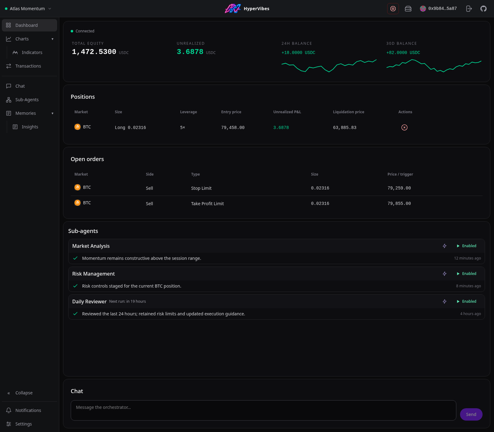

<h1 align="center">HyperVibes</h1>

---

<p align="center">
  Agentic Trading Harness, built on <a href="https://earendil.com/posts/pi-durable/">Pi Durable</a>
</p>

<p align="center">
  <a href="https://hypervibes.ai"></a>
  <a href="https://hypervibes.ai/docs/"></a>
  <a href="https://discord.gg/Up39Qvqmkh"></a>
  <a href="https://x.com/HyperVibesAI"></a>
</p>



## Quick start

HyperVibes is a self-hosted app for running AI trading agents on Hyperliquid.
Install Node.js 22.23.3 or newer and pnpm, then run:

```sh
git clone https://github.com/idft/hypervibes.git
cd hypervibes
pnpm install
pnpm start
```

Open <http://localhost:3003>. No `.env` file is required.

1. Sign in with the browser wallet that owns your Hyperliquid account.
2. Open Account to generate or import a Hyperliquid API key and approve the builder fee. Never import your main wallet's private key.
3. Connect an AI provider, create an agent, and review its instructions and risk settings.

Agents can place real orders. AI can make mistakes, and trading can lose money.
Start with trading disabled while you check your setup.

See the [quick start guide](docs/QuickStart.md) for your first agent.

## Features

- **Batteries included:** agent tools for research, analysis, and trading, ready to use.
- **Self-hosted:** run on your own hardware and keep your data under your control.
- **Decentralized:** trade on Hyperliquid with just an Ethereum account.
- **Built on [Pi Durable](https://earendil.com/posts/pi-durable/):** durable agent execution that survives restarts.

Explore the [user guide](https://hypervibes.ai/docs/) for more.

## Installation

- **From source — available now:** clone the repository, run `pnpm install`, then `pnpm start`. See [Quick start](#quick-start).
- **NPX — coming soon:** run the published npm package without cloning or building the source. The launch command will be added when the package is available.
- **Global npm install — coming soon:** install the published package once and launch it with the `hypervibes` command.
- **Docker Compose — coming with v0.4.0:** run `ghcr.io/idft/hypervibes` on Linux AMD64 or ARM64 using the included [`compose.yaml`](compose.yaml).
- **Desktop download — coming soon:** planned builds for macOS, Windows, and Linux.
- **Local release package:** run `pnpm pack` from a source checkout to build an npm tarball. See [Build](#build).
- **Local container build:** run `pnpm pack --out artifacts/hypervibes.tgz`, then `docker build -f Containerfile -t hypervibes:local .`.

See the [installation guide](docs/Installation.md) for setup, persistent storage,
and remote access.

## Configuration

HyperVibes keeps its SQLite database (`hypervibes.sqlite`) and secrets file
(`config.json`) outside the project:

| OS | Database directory | Config directory |
| --- | --- | --- |
| Linux | `~/.local/share/hypervibes/` | `~/.config/hypervibes/` |
| macOS | `~/Library/Application Support/HyperVibes/` | Same as database |
| Windows | `%APPDATA%\HyperVibes\` | Same as database |

Linux respects `XDG_DATA_HOME` and `XDG_CONFIG_HOME` when set to absolute paths.
Back up both files together; losing the encryption key prevents recovery of stored credentials.

See [Configuration](docs/Configuration.md) for all file settings, environment
variables, and path overrides.

## Development

Install Node.js 22.23.3 or newer and pnpm.

```sh
git clone https://github.com/idft/hypervibes.git
cd hypervibes
pnpm install
pnpm dev
```

Open <http://localhost:3003>. The development server supports hot reload.
See [`AGENTS.md`](AGENTS.md) for architecture and project conventions.

### Build

```sh
pnpm build          # Compiled backend, frontend, and runtime resources
pnpm start:built    # Run that build without rebuilding
pnpm pack           # Rebuild and create a local npm tarball
```

`pnpm start` builds fresh production assets before serving. Keep development
dependencies installed for source builds. The release package exposes the
`hypervibes` executable and needs only Node.js and runtime dependencies to launch.
Run `node bin/hypervibes.js --help` for usage. Public npm releases are coming soon.

### Checks

```sh
pnpm typecheck:server
pnpm lint:server
pnpm test
```

`pnpm test` runs application, startup, container health-check, and screenshot-tool
tests without building the trading app or requiring Docker or Chromium.
For release checks, run `pnpm build`, `pnpm test:build`, and `pnpm test:package`;
package testing performs a clean install.

GitHub Actions validates pull requests, pushes to `master` and `v*` branches,
and manual runs. It tests the release package on Linux, macOS, and Windows,
and non-root containers on native AMD64 and ARM64 runners.
Publishing a GitHub release validates again before publishing images to GHCR.
Tag pushes only create draft releases; branch pushes do not publish images.

## License

HyperVibes is licensed under the [GNU Affero General Public License v3.0 only](LICENSE)
(`AGPL-3.0-only`).

## Disclaimer

HyperVibes is open-source software that can enable agents to submit orders to
Hyperliquid using user-authorized signing keys. It is not financial,
investment, trading, legal, or tax advice, and is not a broker, dealer,
exchange, custodian, or financial intermediary.

Trading digital assets and derivatives involves substantial risk, including the
possible loss of all capital. AI-generated analysis, automated strategies, and
software outputs may be incorrect or unsuitable for any purpose. You are solely
responsible for your trading decisions, agent configuration, credentials,
monitoring, and compliance with applicable laws and regulations.

The software and related materials are provided "as is" without warranties of
any kind. To the maximum extent permitted by law, the authors and copyright
holders are not liable for losses, damages, or expenses arising from use of the
software, including trading losses, software defects, configuration errors,
service outages, or third-party failures.
